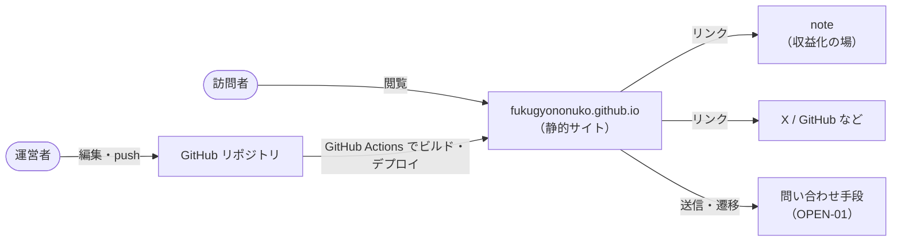
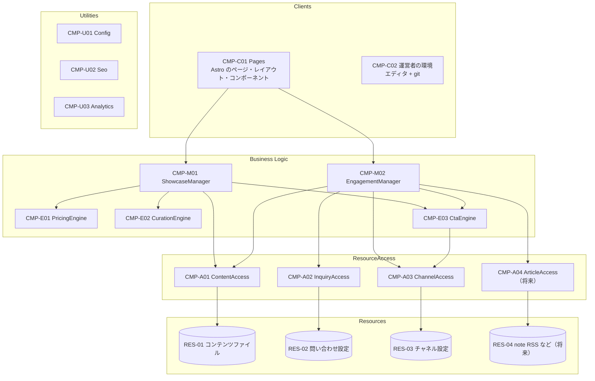

# 1. 概要設計

## 1.1 システムの範囲

本システムは **ビルド時** と **閲覧時** の 2 段階で動く。

| 段階 | 実行場所 | 動くもの |
| --- | --- | --- |
| ビルド時 | GitHub Actions 上の Node.js | Manager、Engine、ResourceAccess、Utility（TypeScript のモジュール）と Astro |
| 閲覧時 | 訪問者のブラウザ | 生成された HTML / CSS と、最小限の JavaScript（問い合わせ時の補助など、Client 層の中だけ） |

The Method の構成要素は、本システムではビルド時に動く同じプロセス内のモジュールになる。サービスやサーバーにはしない。それでも「変わりやすいものを特定の構成要素に閉じ込める」という目的は同じように果たせる。

## 1.2 変動性の分析（VOL）

The Method の 2 つの軸で洗い出した。

- **時間の軸**：同じ運営者でも、時が経つと何が変わるか
- **利用者の軸**：同じ時点でも、利用者（訪問者・運営者）によって何が違うか

| ID | 変動性 | 想定される変化の例 | 軸 | 閉じ込める先 |
| --- | --- | --- | --- | --- |
| VOL-01 | 問い合わせ手段 | Google フォーム → Formspree → DM のみ、など | 時間 | CMP-A02 InquiryAccess |
| VOL-02 | 取引の場と、その場への導線を決めるルール | 問い合わせのみ → 一部のプロダクトは note で販売 → 他の販売サイトを追加 | 時間 | CMP-E03 CtaEngine |
| VOL-03 | 価格の見せ方 | 明記 → 「〜円から」→ 要見積もり。プロダクトによって変える | 時間、利用者 | CMP-E01 PricingEngine |
| VOL-04 | 注目項目の選び方と並び順 | 手動で指定 → 新しい順 → 種類ごとに 1 件ずつ | 時間 | CMP-E02 CurationEngine |
| VOL-05 | コンテンツの保管場所と形式 | リポジトリ内の Markdown / YAML → ヘッドレス CMS など | 時間 | CMP-A01 ContentAccess |
| VOL-06 | 記事の出所 | なし → note の RSS → 自サイトのブログ → その両方 | 時間 | CMP-A04 ArticleAccess |
| VOL-07 | 外部チャネルの種類と URL | note・X・GitHub → チャネルの追加・廃止、アカウントの変更 | 時間 | CMP-A03 ChannelAccess |
| VOL-08 | 公開先とベース URL | GitHub Pages → 独自ドメイン → 別のホスティング | 時間 | CMP-U01 Config |
| VOL-09 | アクセス解析 | なし → Cloudflare Web Analytics → 別のサービス | 時間 | CMP-U03 Analytics |
| VOL-10 | 見た目（デザイン、テーマ、レイアウト） | 配色やフォントの変更、ダーク / ライト、画面幅による違い | 時間、利用者 | CMP-C01 Pages（Client 層） |
| VOL-11 | ユースケースの手順（何をどの順に見せ、どこへつなぐか） | トップに記事一覧を足す、詳細ページから直接 note へ送る | 時間 | CMP-M01 ShowcaseManager / CMP-M02 EngagementManager |

### プロダクトの中身は「変動性」ではなく「データ」

プロダクトの追加、文言の修正、価格の改定は頻繁に起きる。ただし、これらはスキーマの範囲内でデータが変わるだけで、構成要素の設計は変わらない。The Method では、データの変化は変動性として扱わない。本システムでは RES-01（コンテンツファイル）を書き換えるだけで済む。

## 1.3 変動性として扱わないもの

The Method では、起こりそうにないことや、起きたら別のシステムになってしまうことのために設計すると、かえって複雑になると戒めている。以下は意図して閉じ込めない。

| 項目 | 判断の理由 |
| --- | --- |
| 運営者が 1 人であること | 複数人になったら、サイトの性質そのものが変わる |
| 決済をしないこと | BR-03 で収益化は note の役割と決めている。決済を入れるなら別のシステムになる |
| 静的サイトであること | 動的なサーバーが必要になるなら、それはホスティングの変更（VOL-08）ではなく別のシステムになる |
| 多言語化 | 予定がない。必要になったら Client 層と ContentAccess の拡張で対応できるので、今は作り込まない |
| SEO メタ情報の生成方法 | 書き方の規則は安定している。全ページに共通する処理なので Utility（CMP-U02）にまとめるが、変動性としては扱わない |

## 1.4 階層構成

Utilities はどの層からも呼べるので、図では矢印を省いている。

### Manager を 2 つにした理由

Manager は、ユースケースの「手順」の変動性を閉じ込める。ユースケースを手順の性質で分けると、次の 2 つになる。

| Manager | 閉じ込める手順 | 担当するユースケース |
| --- | --- | --- |
| CMP-M01 ShowcaseManager | **見せる**手順：運営者とプロダクトを、どの情報をどう組み合わせて見せるか | UC-01, UC-02 |
| CMP-M02 EngagementManager | **つなぐ**手順：訪問者を、問い合わせや外部の場にどうつなぐか | UC-03, UC-04 |

UC-05（運営者による更新と公開）は、Manager を通さない。運営者の環境（CMP-C02）と CI パイプライン（DD-13）の手順で実現し、スキーマの強制は ContentAccess が担う（FR-14）。

ページ単位（About / Products / Contact）に Manager を作ると機能分解になるので、そうしない。ページの増減は Client 層の変化（VOL-10）として吸収する。

### Engine の共有

CtaEngine は 2 つの Manager の両方から呼ばれる。プロダクト詳細の行動喚起（ShowcaseManager）と問い合わせ導線（EngagementManager）が、同じ導線ルールを使うためである。The Method では、Manager 同士が呼び合うのではなく Engine を共有することを推奨している。

## 1.5 リソース（RES）

| ID | リソース | 実体 | 状態 |
| --- | --- | --- | --- |
| RES-01 | コンテンツファイル | `src/content/` の Markdown / YAML（プロフィール、スキル、実績、プロダクト、表示設定） | 初期 |
| RES-02 | 問い合わせ設定 | `src/content/settings/inquiry.yaml`（手段の種類と接続先） | 初期 |
| RES-03 | チャネル設定 | `src/content/settings/channels.yaml`（外部チャネルの一覧） | 初期 |
| RES-04 | 記事の配信元 | note の RSS など | 将来 |
| RES-05 | 問い合わせの受付先 | 外部のフォームサービスなど（EIF-01、OPEN-01） | 初期 |
| RES-06 | ホスティングと CI | GitHub Pages / GitHub Actions（EIF-03） | 初期 |

RES-05 と RES-06 には、ビルド時の構成要素から直接アクセスしない。RES-05 にはブラウザがフォームを送るだけで、RES-06 はパイプラインからしか使わない。

## 1.6 利用規則

| # | 規則 |
| --- | --- |
| R1 | Client が呼べる Business Logic は Manager だけ。Engine と ResourceAccess を直接呼んではいけない |
| R2 | Manager は Engine、ResourceAccess、Utility を呼べる |
| R3 | Manager から Manager は呼ばない（同期呼び出しの禁止） |
| R4 | Engine は ResourceAccess と Utility を呼べる。Engine から Engine は呼ばない |
| R5 | ResourceAccess は自分のリソースにだけアクセスする。ResourceAccess から ResourceAccess は呼ばない |
| R6 | 上位の層を呼んではいけない（Engine から Manager、ResourceAccess から Engine など） |
| R7 | Utility はどの層からも呼べる。Utility から他の層は呼ばない |
| R8 | ResourceAccess が公開するのは業務の言葉の操作（`listOfferedProducts` など）とし、CRUD やファイルパスを外に出さない |
| R9 | 層と層の間は `src/system/contracts/` の型だけで受け渡す。リソースの生の形式（frontmatter など）を上に漏らさない |

R1〜R7 は dependency-cruiser で CI 検査する（NFR-09、DD-12、TC-A01）。R8 と R9 はレビューで確認する。
