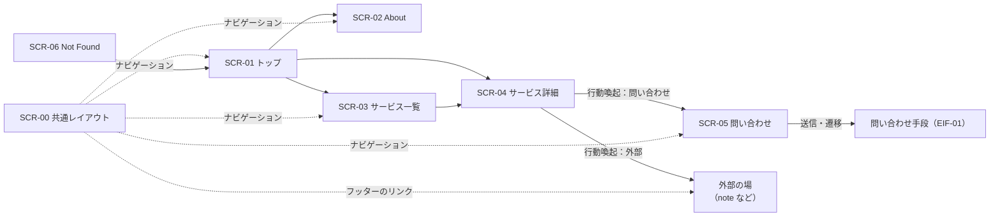

# 2a. 基本設計（外部設計）

## 2a.1 URL の設計

| URL | 画面 | 生成方法 |
| --- | --- | --- |
| `/` | SCR-01 トップ | 静的 |
| `/about/` | SCR-02 About | 静的 |
| `/services/` | SCR-03 サービス一覧 | 静的 |
| `/services/{slug}/` | SCR-04 サービス詳細 | 公開中のサービスごとに静的生成 |
| `/contact/` | SCR-05 問い合わせ | 静的 |
| `/contact/?service={slug}` | SCR-05（サービス指定あり） | 同じ HTML。クエリはブラウザ側で読む |
| `/404.html` | SCR-06 Not Found | 静的（GitHub Pages が自動で使う） |
| `/sitemap-index.xml`, `/robots.txt` | — | ビルド時に生成（NFR-04） |

- 末尾には必ず `/` を付ける。
- `{slug}` は英小文字・数字・ハイフンだけ（DD-02）。公開後は変えない。
- ベース URL は CMP-U01 Config が持つ（VOL-08）。

## 2a.2 画面遷移

## 2a.3 画面一覧

| ID | 画面 | 目的 | 関連する UC / FR |
| --- | --- | --- | --- |
| SCR-00 | 共通レイアウト | すべての画面に共通するヘッダー、フッター、メタ情報 | UC-04 / FR-10, NFR-04, NFR-05 |
| SCR-01 | トップ | 運営者とサービスの要点を示し、詳細へ誘導する | UC-01, UC-02 / FR-09 |
| SCR-02 | About | 運営者のプロフィール、スキル、制作例 | UC-01 / FR-01, FR-02, FR-03 |
| SCR-03 | サービス一覧 | 提供サービスを一覧で示す | UC-02 / FR-04, FR-06 |
| SCR-04 | サービス詳細 | 1 つのサービスの詳細と行動喚起 | UC-02 / FR-05, FR-06, FR-07 |
| SCR-05 | 問い合わせ | 問い合わせ手段を示す | UC-03 / FR-08 |
| SCR-06 | Not Found | 存在しない URL への案内 | — / FR-12 |

## 2a.4 画面項目

「取得元」は、その項目を Client に渡す Manager の操作（02b §2b.2）を表す。

### SCR-00 共通レイアウト

| 項目 | 内容 | 取得元 |
| --- | --- | --- |
| サイト名 | 表示名。トップへのリンク | `ShowcaseManager.getLayoutView` |
| ナビゲーション | About / サービス / 問い合わせ | Client で固定 |
| 外部チャネルのリンク | アイコンとラベル。新しいタブで開く（`rel="noopener"`） | `EngagementManager.getChannelLinks` |
| コピーライト | `© {年} {表示名}` | `ShowcaseManager.getLayoutView` |
| メタ情報 | title、description、canonical、OGP、Twitter Card | 各画面の View に含まれる `meta`（CMP-U02） |
| アクセス解析タグ | 設定があるときだけ出力 | CMP-U03 |

### SCR-01 トップ

| 項目 | 内容 | 取得元 |
| --- | --- | --- |
| ヒーロー | アイコン、表示名、キャッチコピー | `ShowcaseManager.getHomeView` |
| 注目のスキル | 最大 N 件（N は表示設定） | 同上（CMP-E02 で選ぶ） |
| 注目の制作例 | 最大 N 件 | 同上 |
| 注目のサービス | 最大 N 件。カードにはタイトル、要約、価格表示 | 同上（CMP-E02、CMP-E01） |
| 誘導 | 「サービスを見る」「問い合わせる」 | Client で固定 |

### SCR-02 About

| 項目 | 内容 | 取得元 |
| --- | --- | --- |
| プロフィール | アイコン、表示名、自己紹介（Markdown） | `ShowcaseManager.getAboutView` |
| スキル | 分類ごとのスキル一覧 | 同上 |
| 制作例 | 種類のラベル（受託 / 個人制作 / サンプル）、タイトル、概要、時期、外部リンク（あれば）。1 件もないときは欄ごと出さない | 同上（CMP-E02 で並べる） |

### SCR-03 サービス一覧

| 項目 | 内容 | 取得元 |
| --- | --- | --- |
| サービスカード | タイトル、要約、価格表示、詳細へのリンク | `ShowcaseManager.getServiceCatalogView` |
| 0 件のとき | 「準備中です」と表示し、問い合わせへ誘導する | 同上（空配列） |

### SCR-04 サービス詳細

| 項目 | 内容 | 取得元 |
| --- | --- | --- |
| タイトル、要約 | — | `ShowcaseManager.getServiceDetailView` |
| 対象者 | 箇条書き | 同上 |
| 提供内容 | 箇条書き | 同上 |
| 本文 | Markdown | 同上 |
| 価格表示 | ポリシーを適用した文字列と注記 | 同上（CMP-E01） |
| 納期の目安 | 任意 | 同上 |
| 行動喚起 | ボタン 1 つ。行き先は問い合わせ（SCR-05）か外部の場 | 同上（CMP-E03） |

### SCR-05 問い合わせ

| 項目 | 内容 | 取得元 |
| --- | --- | --- |
| 説明文 | 問い合わせの流れ、返信の目安 | `EngagementManager.getContactView` |
| 問い合わせ手段 | 手段の種類に応じた表示（フォーム / 埋め込み / リンク）。§2a.5 | 同上（CMP-A02） |
| 対象サービス | `?service=` があれば件名や選択欄に反映する。JavaScript が無効なら反映せず、そのまま使える | 同上（サービスの選択肢）＋ Client 側の補助スクリプト |

### SCR-06 Not Found

| 項目 | 内容 | 取得元 |
| --- | --- | --- |
| メッセージ | ページが見つからないこと | Client で固定 |
| 誘導 | トップへのリンク | Client で固定 |

## 2a.5 問い合わせ手段の表示

問い合わせ手段の種類（OPEN-01 で決める）ごとの表示方法。種類は CMP-A02 InquiryAccess が返し、Client はそれに応じて描き分けるだけにする。

| 種類 | 表示 | JavaScript が無効のとき |
| --- | --- | --- |
| `form-post` | サイト内のフォームから外部サービスに POST する | そのまま送信できる |
| `embed` | 外部フォームを iframe で埋め込む | 外部フォームへのリンクを代わりに出す |
| `link` | 外部の連絡先（DM、外部フォーム）へのボタン | そのまま使える |

## 2a.6 外部インターフェース（EIF）

| ID | 相手 | 方向 | 方式 | 状態 |
| --- | --- | --- | --- | --- |
| EIF-01 | 問い合わせの受付先（OPEN-01） | ブラウザ → 外部 | HTML フォームの POST、iframe、またはリンク（§2a.5） | 初期 |
| EIF-02 | note | サイト → note | リンク（初期）、RSS の取得（将来、ビルド時） | 初期 / 将来 |
| EIF-03 | GitHub Pages / GitHub Actions | リポジトリ → 公開 | `actions/upload-pages-artifact` と `actions/deploy-pages` | 初期 |
| EIF-04 | アクセス解析（OPEN-06） | ブラウザ → 外部 | 計測スクリプト | 未定 |
| EIF-05 | その他の外部チャネル（X、GitHub など） | サイト → 外部 | リンク | 初期 |

### EIF-01 問い合わせの受付先

- 送る項目：名前（任意）、返信先（必須）、対象サービス（任意）、本文（必須）
- 個人情報はこのサイトに保存しない。受付先のサービスにだけ渡る（NFR-06）。
- 受付先の接続先 URL や ID は RES-02 だけに書く。

### EIF-02 note

- 初期はリンクだけ。URL は RES-03 に書く。
- 将来は、ビルド時に RSS（`https://note.com/{id}/rss`）を取得する（CMP-A04）。取得できなくてもビルドは失敗させず、記事一覧を出さないだけにする（DD-14）。

### EIF-03 GitHub Pages

- `main` への push をきっかけに、ビルド → 検査 → デプロイを順に行う（DD-13）。
- Pages の公開元（Source）は「GitHub Actions」にする。
