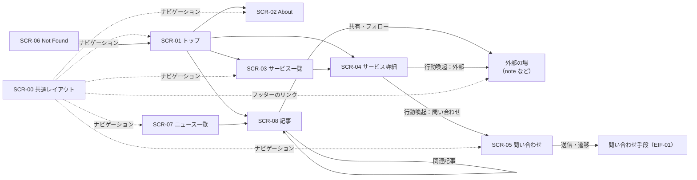

# 2a. 基本設計（外部設計）

## 2a.1 URL の設計

| URL | 画面 | 生成方法 |
| --- | --- | --- |
| `/` | SCR-01 トップ | 静的 |
| `/about/` | SCR-02 About | 静的 |
| `/services/` | SCR-03 サービス一覧 | 静的 |
| `/services/{slug}/` | SCR-04 サービス詳細 | 公開中のサービスごとに静的生成 |
| `/contact/` | SCR-05 問い合わせ | 静的 |
| `/news/` | SCR-07 ニュース一覧 | 静的 |
| `/news/{slug}/` | SCR-08 記事 | 公開中の記事ごとに静的生成 |
| `/news/rss.xml` | — | ビルド時に生成（FR-17） |
| `/contact/?service={slug}` | SCR-05（サービス指定あり） | 同じ HTML。クエリはブラウザ側で読む |
| `/404.html` | SCR-06 Not Found | 静的（GitHub Pages が自動で使う） |
| `/sitemap-index.xml`, `/robots.txt` | — | ビルド時に生成（NFR-04） |

- 末尾には必ず `/` を付ける。
- `{slug}` は英小文字・数字・ハイフンだけ（DD-02）。公開後は変えない。
- ベース URL は CMP-U01 Config が持つ（VOL-08）。

## 2a.2 画面遷移



## 2a.3 画面一覧

| ID | 画面 | 目的 | 関連する UC / FR |
| --- | --- | --- | --- |
| SCR-00 | 共通レイアウト | すべての画面に共通するヘッダー、フッター、メタ情報 | UC-04 / FR-10, NFR-04, NFR-05 |
| SCR-01 | トップ | 運営者とサービスの要点、最新のニュースを示し、詳細へ誘導する | UC-01, UC-02, UC-06 / FR-09, FR-11 |
| SCR-02 | About | 運営者のプロフィール、スキル、制作例 | UC-01 / FR-01, FR-02, FR-03 |
| SCR-03 | サービス一覧 | 提供サービスを一覧で示す | UC-02 / FR-04, FR-06 |
| SCR-04 | サービス詳細 | 1 つのサービスの詳細と行動喚起 | UC-02 / FR-05, FR-06, FR-07 |
| SCR-05 | 問い合わせ | 問い合わせ手段を示す | UC-03 / FR-08 |
| SCR-06 | Not Found | 存在しない URL への案内 | — / FR-12 |
| SCR-07 | ニュース一覧 | 記事を新しい順にカードで示す | UC-06 / FR-11, FR-17, FR-18 |
| SCR-08 | 記事 | 1 つの記事と、共有・フォロー・関連記事 | UC-06, UC-04 / FR-11, FR-15, FR-16, FR-18 |

## 2a.4 画面項目

「取得元」は、その項目を Client に渡す Manager の操作（02b §2b.2）を表す。

### SCR-00 共通レイアウト

| 項目 | 内容 | 取得元 |
| --- | --- | --- |
| サイト名 | 表示名。トップへのリンク | `ShowcaseManager.getLayoutView` |
| ナビゲーション | About / サービス / ニュース / 問い合わせ | Client で固定 |
| 外部チャネルのリンク | アイコンとラベル。新しいタブで開く（`rel="noopener noreferrer"`） | `EngagementManager.getChannelLinks` |
| コピーライト | `© {年} {表示名}` | `ShowcaseManager.getLayoutView` |
| メタ情報 | title、description、canonical、OGP、Twitter Card | 各画面の View に含まれる `meta`（CMP-U02） |
| アクセス解析タグ | 設定があるときだけ出力 | CMP-U03 |

### SCR-01 トップ

| 項目 | 内容 | 取得元 |
| --- | --- | --- |
| ヒーロー | アイコン、表示名、キャッチコピー | `ShowcaseManager.getHomeView` |
| 注目のスキル | 最大 N 件（N は表示設定） | 同上（CMP-E02 で選ぶ） |
| 注目の制作例 | 最大 N 件 | 同上 |
| 最新のニュース | 最大 3 件の記事カード（SCR-07 と同じ形。読む時間の目安を含む）と、一覧へのリンク。「サービス」の上に置く。0 件なら欄ごと出さない | `EngagementManager.getArticleFeedView(3)` |
| 注目のサービス | 最大 N 件。カードにはタイトル、要約、価格表示 | `ShowcaseManager.getHomeView`（CMP-E02、CMP-E01） |
| 誘導 | 「サービスを見る」「問い合わせる」 | Client で固定 |

### SCR-02 About

| 項目 | 内容 | 取得元 |
| --- | --- | --- |
| プロフィール | アイコン、表示名、自己紹介（Markdown） | `ShowcaseManager.getAboutView` |
| スキル | 分類ごとのスキル一覧 | 同上 |
| 制作例 | 種類のラベル（受託 / 個人制作 / サンプル）、タイトル、概要、時期、外部リンク（あれば）。1 件もないときは欄ごと出さない | 同上（CMP-E02 で並べる） |

### SCR-03 サービス一覧

| 項目 | 内容 | 取得元 |
| --- | --- | --- |
| サービスカード | タイトル、要約、価格表示、詳細へのリンク | `ShowcaseManager.getServiceCatalogView` |
| 0 件のとき | 「準備中です」と表示し、問い合わせへ誘導する | 同上（空配列） |

### SCR-04 サービス詳細

| 項目 | 内容 | 取得元 |
| --- | --- | --- |
| タイトル、要約 | — | `ShowcaseManager.getServiceDetailView` |
| 対象者 | 箇条書き | 同上 |
| 提供内容 | 箇条書き | 同上 |
| 本文 | Markdown | 同上 |
| 価格表示 | ポリシーを適用した文字列と注記 | 同上（CMP-E01） |
| 納期の目安 | 任意 | 同上 |
| 行動喚起 | ボタン 1 つ。行き先は問い合わせ（SCR-05）か外部の場 | 同上（CMP-E03） |

### SCR-05 問い合わせ

| 項目 | 内容 | 取得元 |
| --- | --- | --- |
| 説明文 | 問い合わせの流れ、返信の目安 | `EngagementManager.getContactView` |
| 問い合わせ手段 | 手段の種類に応じた表示（フォーム / 埋め込み / リンク）。§2a.5 | 同上（CMP-A02） |
| 対象サービス | `?service=` があれば件名や選択欄に反映する。JavaScript が無効なら反映せず、そのまま使える | 同上（サービスの選択肢）＋ Client 側の補助スクリプト |

### SCR-06 Not Found

| 項目 | 内容 | 取得元 |
| --- | --- | --- |
| メッセージ | ページが見つからないこと | Client で固定 |
| 誘導 | トップへのリンク | Client で固定 |

### SCR-07 ニュース一覧

| 項目 | 内容 | 取得元 |
| --- | --- | --- |
| 記事カード | 画像（なければ既定の画像）、分類、公開日、読む時間の目安、見出し、要約。カード全体が記事へのリンク。新しい順 | `EngagementManager.getNewsIndexView` |
| 0 件のとき | 「ニュースは準備中です」 | 同上（空配列） |
| RSS | `/news/rss.xml` へのリンク | 同上 |

### SCR-08 記事

ユーザーが示した資料（NASA のニュースリリースのページ）と同じく、PC 幅（64rem 以上）では 2 列にする（#38）。スマホでは縦 1 列にし、下の表の「順」に上から並べる。

```
PC 幅                                   スマホ
┌───────────┬──────────────────────┐   ┌──────────────┐
│           │ 1 読む時間            │   │ 1 読む時間    │
│           │ 2 見出し（h1）         │   │ 2 見出し      │
├───────────┼──────────────────────┤   │ 3 筆者        │
│ 3 筆者     │ 7 画像（16:9）        │   │ 4 日付        │
│ 4 日付     │   キャプション         │   │ 5 分類        │
│ 5 分類     │   クレジット           │   │ 6 共有        │
│ 6 共有     │ 8 本文                │   │ 7 画像        │
│ （横線で   │ 9 共有（下）           │   │ 8 本文        │
│   区切る） │ 10 フォロー            │   │ 9〜12        │
│           │ 11 タグ               │   └──────────────┘
└───────────┴──────────────────────┘
 12 関連記事（2 列の下に全幅）
```

| 順 | 項目 | 内容 | 取得元 |
| --- | --- | --- | --- |
| 1 | 読む時間 | 「◯ 分で読めます」（FR-18） | `EngagementManager.getNewsArticleView`（CMP-E04） |
| 2 | 見出し | `h1` | 同上 |
| 3 | 筆者 | 運営者のアイコンと表示名 | 同上（CMP-A01） |
| 4 | 日付 | 公開日。更新日があれば「更新：」を添える。`<time datetime>` | 同上 |
| 5 | 分類 | お知らせ / 制作 / 読み物 | 同上 |
| 6 | 共有（上） | X・Threads・はてなブックマークの共有リンク（新しいタブ）と、リンクのコピー（JavaScript が有効なときだけ表示） | 同上（CMP-A03）＋ Client 側の補助スクリプト |
| 7 | 画像 | 16:9 の大きな画像、キャプション（任意）、クレジット（任意。「クレジット：…」）。画像がない記事では出さない | 同上 |
| 8 | 本文 | Markdown。幅は約 40 文字（`40rem`） | 同上 |
| 9 | 共有（下） | 6 と同じ | 同上 |
| 10 | フォロー | 外部チャネル（RES-03）へのリンク。「副業のぬこをフォローする」 | 同上（CMP-A03） |
| 11 | タグ | タグの一覧（文字だけ。タグ別の一覧ページは作らない） | 同上 |
| 12 | 関連記事 | 最大 3 件の記事カード。0 件なら欄ごと出さない | 同上（CMP-E02） |
| — | 一覧へ戻る | 「ニュースの一覧へ」 | Client で固定 |

- 左の列（3〜6）は、参考のページと同じく固定しない（スクロールで流れる）。

## 2a.5 問い合わせ手段の表示

問い合わせ手段の種類（OPEN-01 で決める）ごとの表示方法。種類は CMP-A02 InquiryAccess が返し、Client はそれに応じて描き分けるだけにする。

| 種類 | 表示 | JavaScript が無効のとき |
| --- | --- | --- |
| `form-post` | サイト内のフォームから外部サービスに POST する | そのまま送信できる |
| `embed` | 外部フォームを iframe で埋め込む | 外部フォームへのリンクを代わりに出す |
| `link` | 外部の連絡先（DM、外部フォーム）へのボタン | そのまま使える |

## 2a.6 外部インターフェース（EIF）

| ID | 相手 | 方向 | 方式 | 状態 |
| --- | --- | --- | --- | --- |
| EIF-01 | 問い合わせの受付先（OPEN-01） | ブラウザ → 外部 | HTML フォームの POST、iframe、またはリンク（§2a.5） | 初期 |
| EIF-02 | note | サイト → note | リンク（初期）、RSS の取得（将来、ビルド時） | 初期 / 将来 |
| EIF-03 | GitHub Pages / GitHub Actions | リポジトリ → 公開 | `actions/upload-pages-artifact` と `actions/deploy-pages` | 初期 |
| EIF-04 | アクセス解析（OPEN-06） | ブラウザ → 外部 | 計測スクリプト | 未定 |
| EIF-05 | その他の外部チャネル（X、GitHub など） | サイト → 外部 | リンク | 初期 |
| EIF-06 | 記事の共有先（X、Threads、はてなブックマーク） | ブラウザ → 外部 | 共有用 URL へのリンク（外部スクリプトは読み込まない） | 初期 |
| EIF-07 | RSS リーダー | 外部 → サイト | `/news/rss.xml`（RSS 2.0）を取得する | 初期 |

### EIF-01 問い合わせの受付先

- 送る項目：名前（任意）、返信先（必須）、対象サービス（任意）、本文（必須）
- 個人情報はこのサイトに保存しない。受付先のサービスにだけ渡る（NFR-06）。
- 受付先の接続先 URL や ID は RES-02 だけに書く。

### EIF-02 note

- 初期はリンクだけ。URL は RES-03 に書く。
- 将来、note の記事もニュースに並べるときは、ビルド時に RSS（`https://note.com/{id}/rss`）を取得する（CMP-A04）。取得できなくてもビルドは失敗させず、note の記事を出さないだけにする（DD-14）。

### EIF-06 記事の共有先

- 共有ボタンは、各サービスの共有用 URL へのリンクにする。共有先の埋め込みスクリプトやボタンの画像は読み込まない（NFR-15、NFR-16。CSP を変えずに済む）。
- 共有先と URL の形は RES-03（`share-targets.yaml`）に書く。記事の URL と見出しは、URL エンコードして埋め込む（DD-07）。
- 新しいタブで開き、`rel="noopener noreferrer"` を付ける（`ExternalLink.astro`）。
- 「リンクのコピー」は外部に何も送らない。ブラウザのクリップボード API で記事の URL をコピーする。

### EIF-07 RSS リーダー

- RSS 2.0。項目は見出し、記事の絶対 URL、公開日（RFC 822）、要約。新しい順に全件（記事が増えたら件数を絞る）。
- 共通レイアウトの `<head>` に `<link rel="alternate" type="application/rss+xml">` を置く。

### EIF-03 GitHub Pages

- `main` への push をきっかけに、ビルド → 検査 → デプロイを順に行う（DD-13）。
- Pages の公開元（Source）は「GitHub Actions」にする。

## 2a.7 デザイン（OPEN-05 の結論）

### コンセプト

**木漏れ日の砂浜でひと休みするカモメ。** 運営者のアイコンの写真の雰囲気に合わせる。

- 明るく、静かで、余白を多くとる。売り込みの強さよりも、落ち着いて相談できそうな印象を優先する。
- 色はアイコンの写真（砂・海・カモメ・草・くちばし）から取る。
- ダークモードは「夕方の浜辺」。同じ色の役割を暗い背景に置き換える。

### 配色（`src/styles/tokens.css`）

| 役割 | トークン | ライト | ダーク | 由来 |
| --- | --- | --- | --- | --- |
| 背景 | `--color-bg` | `#f6f2ea` | `#1b2128` | 日なたの砂 / 夕方の浜 |
| カード | `--color-surface` | `#fffdf8` | `#232b33` | — |
| くぼみ・フッター | `--color-sunken` | `#ece6da` | `#161b21` | 日陰の砂 |
| 境界線 | `--color-border` | `#ddd5c7` | `#34404b` | — |
| 本文 | `--color-text` | `#2e3236` | `#ece7de` | カモメの羽の先 |
| 補足の文字 | `--color-text-muted` | `#5b6167` | `#aab2ba` | カモメの背 |
| リンク・主要ボタン | `--color-sea` | `#3d6585` | `#9cc0de` | 海 |
| 主要ボタン上の文字 | `--color-on-sea` | `#ffffff` | `#13202b` | — |
| 淡いアクセント | `--color-sea-soft` | `#dbe6f0` | `#2a3b4c` | 浅瀬 |
| 補助のアクセント | `--color-grass` | `#5f7f43` | `#9dbb7c` | 草 |
| 小さな装飾 | `--color-beak` | `#c8674a` | `#e08b6e` | くちばし（文字には使わない） |

文字と背景の組み合わせは、すべてコントラスト比 4.5 以上（WCAG 2.2 AA）を満たす（NFR-03）。

| 組み合わせ | ライト | ダーク |
| --- | --- | --- |
| 本文 / 背景 | 11.6 | 13.2 |
| 補足の文字 / 背景 | 5.6 | 7.6 |
| 補足の文字 / フッター | 5.0 | 8.1 |
| リンク / 背景 | 5.5 | 8.5 |
| 主要ボタンの文字 / ボタン | 6.2 | 8.7 |

### 文字

| 用途 | フォント | 理由 |
| --- | --- | --- |
| 見出し、サイト名、キャッチコピー | Zen Maru Gothic（700 のみ、OFL） | 丸みがあり、やわらかい印象。サイト内から配信する（CSP の `font-src 'self'` を保つ）。ビルドのあとに、見出しで実際に使う文字だけに絞ったフォント（サブセット、約 20KB）を作る（`scripts/subset-heading-font.mjs`）。`@fontsource` の CSS（文字の範囲ごとの `@font-face`、約 100KB）が表示を遅らせ、性能が基準（90 点）を割ったため（TC-N01） |
| 本文 | OS の標準フォント（ヒラギノ角ゴ、Noto Sans JP など） | 読みやすさと表示速度（NFR-02） |

- 日本語は文節で折り返す（`word-break: auto-phrase`）。
- 本文の行間は 1.8。

### 形と装飾

- 角は大きめの丸み（写真は `1.75rem`、ボタンは完全な丸）。
- フッターの上端は、ゆるい波の形にする。
- 影は薄く、ぼかしを大きくする（木陰のような柔らかさ）。
- 動きはホバー時のわずかな浮き上がりだけ。`prefers-reduced-motion` のときは止める。

### 画像

| ファイル | 用途 | 大きさ |
| --- | --- | --- |
| `public/images/hero-800.webp`、`hero-1600.webp` | トップの写真（画面幅に応じて切り替え） | 幅 800 / 1600px |
| `public/images/avatar-320.webp` | ヘッダーのアイコン（カモメの部分を正方形に切り抜き） | 320px |
| `public/favicon.png`、`apple-touch-icon.png` | ブラウザのタブ、ホーム画面 | 64 / 180px |
| `public/og-default.jpg` | SNS で共有されたときの画像 | 1200 × 630px |
| `public/images/news/{slug}.webp` など | 記事の画像（任意）。SCR-08 の大きな画像、記事カード、記事の OGP 画像に使う。画像のない記事では、カードに既定の画像（`og-default.jpg`）を出す | 幅 1600px まで、16:9 を推奨 |

- 元の写真は運営者が SNS のアイコンに使っているもの。
- すべて EXIF などのメタデータを削除してから置く（NFR-06）。CI で検査する（TC-N15）。

### 共通の部品（CMP-C01）

| 部品 | 役割 |
| --- | --- |
| `Header.astro` | サイト名とアイコン、ナビゲーション（現在のページを `aria-current` で示す） |
| `Footer.astro` | 外部チャネルのリンク、コピーライト |
| `Button.astro` | ボタン型のリンク（主要 / 補助の 2 種類） |
| `ExternalLink.astro` | 外部リンクを出す唯一の部品（NFR-16） |
| `Section.astro` | 見出しつきのセクション |
| `ServiceCard.astro`、`WorkList.astro` | サービスのカード、制作例の一覧（種類のラベルつき） |
| `ArticleCard.astro` | 記事のカード（画像、分類、公開日、読む時間の目安、見出し、要約）。SCR-01、SCR-07、SCR-08 の関連記事で使う |
| `ShareButtons.astro` | 共有リンクとリンクのコピー（SCR-08 の上と下） |
| `inquiry/{FormPost,Embed,Link}.astro` | 問い合わせ手段の種類ごとの表示（§2a.5） |

レイアウトの決まり：

- 本文の最大幅は `64rem`。左右の余白はスマホで `1rem`、幅 48rem 以上で `2rem`。
- ヘッダーは画面上部に固定し、背景を少し透かす。
- キーボード操作のために「本文へ移動」のリンクを先頭に置き、フォーカス位置をはっきり示す（NFR-03）。
