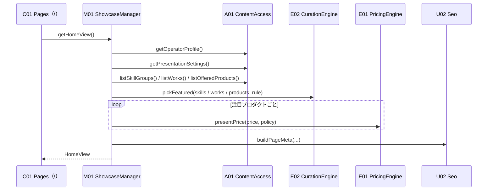
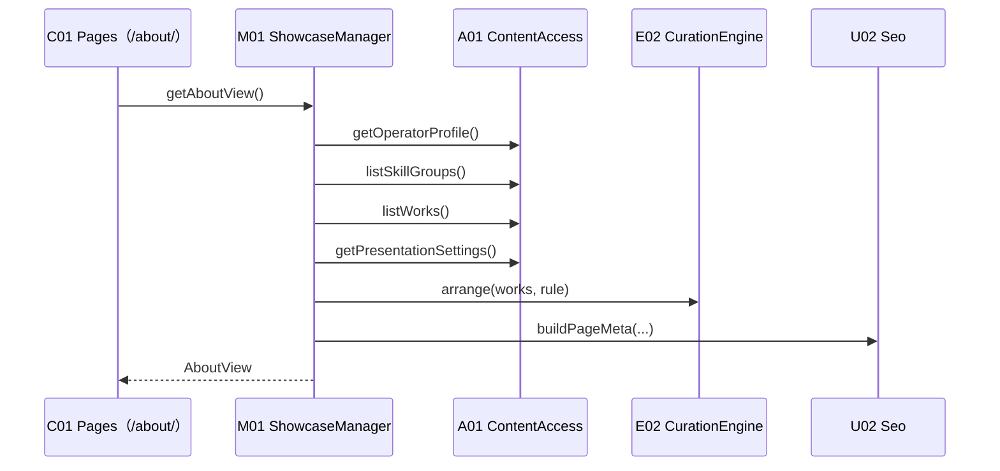
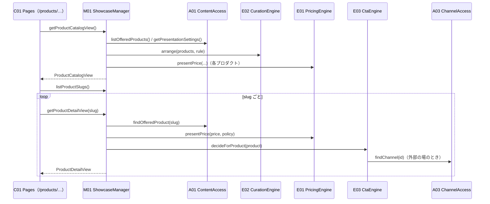
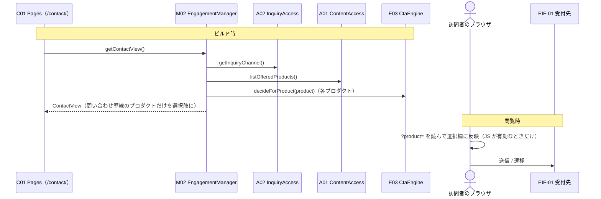
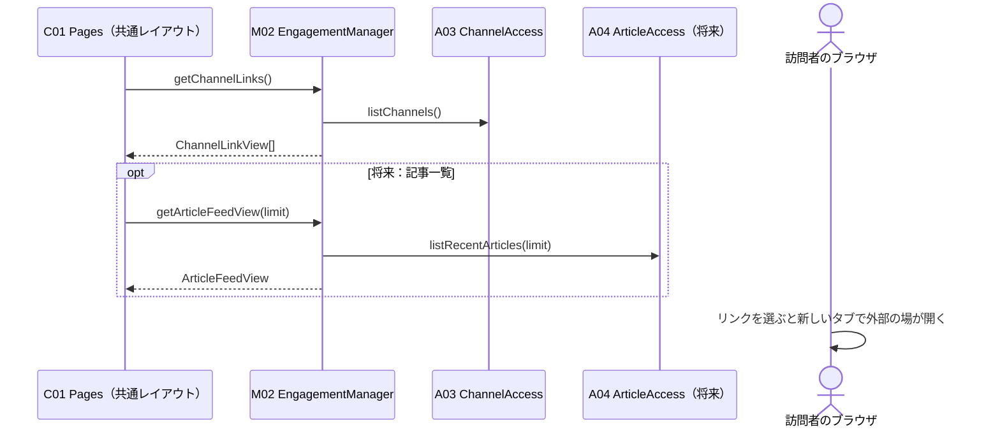
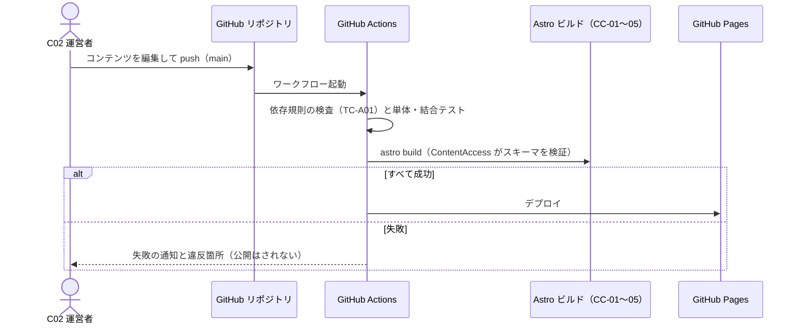

# 2b. 基本設計（内部設計）

## 2b.1 構成要素の一覧

| ID | 構成要素 | 層 | 閉じ込める変動性 | 状態 |
| --- | --- | --- | --- | --- |
| CMP-C01 | Pages | Client | VOL-10 | 初期 |
| CMP-C02 | 運営者の環境 | Client | — | 初期 |
| CMP-M01 | ShowcaseManager | Manager | VOL-11（見せる手順） | 初期 |
| CMP-M02 | EngagementManager | Manager | VOL-11（つなぐ手順） | 初期 |
| CMP-E01 | PricingEngine | Engine | VOL-03 | 初期 |
| CMP-E02 | CurationEngine | Engine | VOL-04 | 初期 |
| CMP-E03 | CtaEngine | Engine | VOL-02 | 初期 |
| CMP-A01 | ContentAccess | ResourceAccess | VOL-05 | 初期 |
| CMP-A02 | InquiryAccess | ResourceAccess | VOL-01 | 初期 |
| CMP-A03 | ChannelAccess | ResourceAccess | VOL-07 | 初期 |
| CMP-A04 | ArticleAccess | ResourceAccess | VOL-06 | 将来 |
| CMP-U01 | Config | Utility | VOL-08 | 初期 |
| CMP-U02 | Seo | Utility | —（§1.3） | 初期 |
| CMP-U03 | Analytics | Utility | VOL-09 | 初期 |

## 2b.2 責務と契約

各操作の型は 03 §3.1（DD-01）で定義する。ここでは責務と、操作の意味だけを決める。

### CMP-C01 Pages（Client）
- 責務：Manager から受け取った View を HTML にする。見た目とレイアウトのすべて。
- 知ってはいけないこと：コンテンツファイルの場所や形式、価格表示や導線のルール、問い合わせ先の接続情報。
- 閲覧時に動く JavaScript は Client の中だけに置く（問い合わせ時のプロダクト指定の補助など）。

### CMP-C02 運営者の環境（Client）
- 責務：コンテンツファイルを編集し、`main` に push する。
- 決められたスキーマ（DD-02）に従ってコンテンツを書く。

### CMP-M01 ShowcaseManager
- 責務：運営者とプロダクトを「見せる」手順の組み立て。

| 操作 | 意味 | 呼び出す相手 |
| --- | --- | --- |
| `getLayoutView()` | 共通レイアウトに必要な、運営者に関する情報 | A01 |
| `getHomeView()` | トップに出す注目項目 | A01, E02, E01, U02 |
| `getAboutView()` | プロフィール、スキル、実績 | A01, E02, U02 |
| `getProductCatalogView()` | 公開中のプロダクトの一覧（価格表示つき） | A01, E02, E01, U02 |
| `listProductSlugs()` | 詳細ページを生成するプロダクトの slug 一覧 | A01 |
| `getProductDetailView(slug)` | 1 プロダクトの詳細（価格表示と行動喚起つき） | A01, E01, E03, U02 |

### CMP-M02 EngagementManager
- 責務：訪問者を問い合わせや外部の場に「つなぐ」手順の組み立て。

| 操作 | 意味 | 呼び出す相手 |
| --- | --- | --- |
| `getChannelLinks()` | 共通フッターに出す外部チャネルのリンク | A03 |
| `getContactView()` | 問い合わせ手段と、問い合わせで指定できるプロダクトの選択肢 | A02, A01, E03, U02 |
| `getArticleFeedView(limit)` | 最新記事の一覧（将来） | A04 |

`getContactView` は、各プロダクトについて CtaEngine に導線を判定させ、導線が「問い合わせ」のプロダクトだけを選択肢にする。note で販売しているプロダクトを問い合わせの選択肢に出さないため。

### CMP-E01 PricingEngine
- 責務：プロダクトの価格情報と価格表示ポリシーから、表示用の価格を決める（VOL-03）。
- `presentPrice(price, policy)`：表示する文字列、注記、表示の種類を返す。リソースにはアクセスしない（純粋な関数）。

### CMP-E02 CurationEngine
- 責務：項目の集合から、注目項目を選び、並べる（VOL-04）。
- `pickFeatured(items, rule)`：規則に従って最大 N 件を選ぶ。
- `arrange(items, rule)`：規則に従って並べる。
- スキル、実績、プロダクトに共通の「並べられる項目」（`Curatable`）として扱い、種類ごとの違いを知らない。

### CMP-E03 CtaEngine
- 責務：プロダクトごとに、訪問者をどこにつなぐかを決める（VOL-02）。
- `decideForProduct(product)`：行き先（問い合わせ / 外部の場）、リンク先、ラベルを返す。
- 外部の場の URL は CMP-A03 ChannelAccess から得る。存在しないチャネルが指定されていたらエラーにする（DD-14）。

### CMP-A01 ContentAccess
- 責務：コンテンツ（RES-01）を業務の言葉で提供する。保管場所と形式を隠す（VOL-05）。

| 操作 | 意味 |
| --- | --- |
| `getOperatorProfile()` | 運営者のプロフィール |
| `listSkillGroups()` | 分類ごとのスキル |
| `listWorks()` | 公開する実績 |
| `listOfferedProducts()` | 公開中のプロダクト（下書きは含めない） |
| `findOfferedProduct(slug)` | 公開中のプロダクト 1 件。なければ `undefined` |
| `getPresentationSettings()` | 価格表示ポリシー、注目項目の選び方などの表示設定 |

- スキーマ違反のコンテンツはビルドを失敗させる（FR-14）。

### CMP-A02 InquiryAccess
- 責務：その時点の問い合わせ手段（RES-02）を提供する。手段の種類と接続先を隠す（VOL-01）。
- `getInquiryChannel()`：手段の種類（`form-post` / `embed` / `link`）と、表示に必要な情報を返す。

### CMP-A03 ChannelAccess
- 責務：外部チャネルの一覧（RES-03）を提供する（VOL-07）。
- `listChannels()`：表示順に並んだ外部チャネル。
- `findChannel(id)`：チャネル 1 件。なければ `undefined`。

### CMP-A04 ArticleAccess（将来）
- 責務：記事の出所（note の RSS、自サイトのブログなど）を隠して、記事の一覧を提供する（VOL-06）。
- `listRecentArticles(limit)`：新しい順に最大 `limit` 件。取得に失敗したら空の一覧を返し、警告を出す。

### CMP-U01 Config
- 責務：公開先に関わる設定（サイト URL、ベースパス、言語）を提供する（VOL-08）。
- `getSiteConfig()`

### CMP-U02 Seo
- 責務：画面ごとのメタ情報（title、description、canonical、OGP）を組み立てる。
- `buildPageMeta(input)`：Config を使って絶対 URL を作る。

### CMP-U03 Analytics
- 責務：アクセス解析のタグを提供する（VOL-09）。
- `getAnalyticsTag()`：設定がなければ `null`。

## 2b.3 コールチェーン（CC）

設計した構成要素の組み合わせで、すべてのコアユースケースを実現できることを示す。矢印はすべて 01 §1.6 の利用規則に従っている。

| ID | コールチェーン | 実現する UC |
| --- | --- | --- |
| CC-01 | トップの表示 | UC-01, UC-02 |
| CC-02 | About の表示 | UC-01 |
| CC-03 | プロダクト一覧・詳細の表示 | UC-02 |
| CC-04 | 問い合わせ | UC-03 |
| CC-05 | 外部の場への移動 | UC-04 |
| CC-06 | コンテンツの更新と公開 | UC-05 |

### CC-01 トップの表示（ビルド時）

共通レイアウトの部分は、どの画面でも `ShowcaseManager.getLayoutView()` と `EngagementManager.getChannelLinks()` を呼ぶ（CC-05 を参照）。

### CC-02 About の表示（ビルド時）

### CC-03 プロダクト一覧・詳細の表示（ビルド時）

### CC-04 問い合わせ

### CC-05 外部の場への移動

プロダクト詳細の行動喚起からの移動は CC-03 で解決済みのリンクを使う。

### CC-06 コンテンツの更新と公開

## 2b.4 変動性への対応の確認

各変動性が起きたとき、変更が 1 つの構成要素（とデータ・設定）の中で済むことを確認する。テストとしては TC-R01〜TC-R11（04 §4.6）でレビューする。

| VOL | 変化の例 | 変える場所 | 変えなくてよい場所 |
| --- | --- | --- | --- |
| VOL-01 | Google フォーム → Formspree | A02 と RES-02 | Manager、Engine、ページ（手段の種類が既存の 3 種類に収まる場合） |
| VOL-02 | 一部のプロダクトを note で販売 | RES-01 のプロダクトに導線を指定。ルール自体を変えるなら E03 | Manager、ページ |
| VOL-03 | 「〜円から」に統一 | RES-01 の表示設定。新しい見せ方なら E01 | それ以外のすべて |
| VOL-04 | 注目項目を新しい順に | RES-01 の表示設定。新しい規則なら E02 | それ以外のすべて |
| VOL-05 | CMS に移行 | A01 | Manager、Engine、ページ |
| VOL-06 | note の RSS → 自サイトのブログ | A04 | M02、ページ |
| VOL-07 | チャネルを追加 | RES-03 | それ以外のすべて |
| VOL-08 | 独自ドメインに移行 | U01（と DNS） | それ以外のすべて |
| VOL-09 | アクセス解析を導入 | U03 と設定 | それ以外のすべて |
| VOL-10 | デザインを変更 | C01 | Business Logic 以下のすべて |
| VOL-11 | トップに記事一覧を追加 | M01 / M02 の手順と C01 の表示 | Engine、ResourceAccess |
