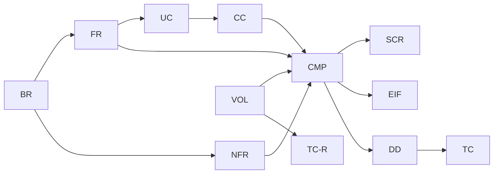

# トレーサビリティ表

要件から設計・テストまでを ID でつなぐ。上流から下流へ（§T.1〜§T.5）と、構成要素からの逆引き（§T.6）の両方向でたどれる。
設計を変える PR では、この表も同じ PR で更新する（[README](README.md) の ID の規則）。

## T.1 ビジネス要件 → 機能要件・非機能要件

| BR | FR | NFR |
| --- | --- | --- |
| BR-01 能力を伝える | FR-01, FR-02, FR-03, FR-09, FR-11, FR-16 | NFR-01, NFR-02, NFR-03, NFR-04, NFR-05, NFR-10 |
| BR-02 サービスを示し依頼につなげる | FR-04, FR-05, FR-06, FR-07, FR-08, FR-09 | NFR-01, NFR-02, NFR-03, NFR-04, NFR-10 |
| BR-03 収益化の場（現時点では note）への導線 | FR-07, FR-10, FR-11, FR-15, FR-17 | NFR-04, NFR-10 |
| BR-04 維持費ゼロ・更新が簡単 | FR-12, FR-13, FR-14 | NFR-07 |
| BR-05 変化に対応できる | — | NFR-08, NFR-09 |
| BR-06 個人情報を出さない | — | NFR-06, NFR-14, NFR-17 |
| BR-07 改ざん・悪用をされない | — | NFR-11, NFR-12, NFR-13, NFR-14, NFR-15, NFR-16, NFR-17, NFR-18 |

## T.2 機能要件 → ユースケース → 構成要素 → 画面・外部 IF → 詳細設計 → テスト

| FR | UC | 構成要素 | 画面 / 外部 IF | 詳細設計 | テスト | 状態 |
| --- | --- | --- | --- | --- | --- | --- |
| FR-01 プロフィール | UC-01 | C01, M01, A01 | SCR-01, SCR-02 | DD-01, DD-02, DD-09, DD-11 | TC-U04, TC-I01, TC-S01 | 初期 |
| FR-02 スキル | UC-01 | C01, M01, E02, A01 | SCR-01, SCR-02 | DD-02, DD-04, DD-09 | TC-U02, TC-U04, TC-I01, TC-S01 | 初期 |
| FR-03 制作例 | UC-01 | C01, M01, E02, A01 | SCR-01, SCR-02 | DD-02, DD-04, DD-09 | TC-U02, TC-U04, TC-I01, TC-S01, TC-S10 | 初期 |
| FR-04 サービス一覧 | UC-02 | C01, M01, E01, E02, A01 | SCR-03 | DD-02, DD-04, DD-09, DD-11 | TC-U04, TC-I01, TC-S01, TC-S02, TC-S10 | 初期 |
| FR-05 サービス詳細 | UC-02 | C01, M01, E01, E03, A01 | SCR-04 | DD-02, DD-09, DD-11 | TC-I01, TC-S01, TC-S02 | 初期 |
| FR-06 価格表示ポリシー | UC-02 | M01, E01, A01 | SCR-01, SCR-03, SCR-04 | DD-02, DD-03 | TC-U01, TC-I01, TC-R03 | 初期 |
| FR-07 行動喚起 | UC-02, UC-03, UC-04 | M01, M02, E03, A03 | SCR-04, SCR-05 | DD-05 | TC-U03, TC-I01, TC-I02, TC-S02, TC-S03, TC-R02 | 初期 |
| FR-08 問い合わせ手段 | UC-03 | C01, M02, A02 | SCR-05 / EIF-01 | DD-06, DD-11, DD-16 | TC-U05, TC-I02, TC-S02, TC-N14 | 初期 |
| FR-09 注目項目 | UC-01, UC-02 | M01, E02 | SCR-01 | DD-04, DD-09 | TC-U02, TC-I01, TC-S01 | 初期 |
| FR-10 外部チャネルのリンク | UC-04 | C01, M02, A03 | SCR-00 / EIF-02, EIF-05 | DD-07, DD-11 | TC-U06, TC-I02, TC-S04, TC-N13 | 初期 |
| FR-11 ニュース | UC-06 | C01, M02, A04, A01, U02 | SCR-01, SCR-07, SCR-08 | DD-01, DD-08, DD-09, DD-11 | TC-U07, TC-I02, TC-S01, TC-S09, TC-S11, TC-R06 | 初期 |
| FR-12 404 | — | C01 | SCR-06 | DD-11 | TC-S05, TC-S08 | 初期 |
| FR-13 push で公開 | UC-05 | C02 | EIF-03 | DD-13 | TC-S06 | 初期 |
| FR-14 スキーマ違反で公開中止 | UC-05 | A01, A02, A03, A04, E03 | EIF-03 | DD-02, DD-06, DD-07, DD-08, DD-14 | TC-U04, TC-U05, TC-U06, TC-U07, TC-S07 | 初期 |
| FR-15 共有とフォロー | UC-06, UC-04 | C01, M02, A03 | SCR-08 / EIF-05, EIF-06 | DD-07, DD-09, DD-11, DD-16 | TC-U06, TC-I02, TC-S09, TC-S12, TC-N13, TC-R07 | 初期 |
| FR-16 関連記事 | UC-06 | M02, E02, A04 | SCR-08 | DD-04, DD-09 | TC-U10, TC-I02, TC-S11 | 初期 |
| FR-17 RSS | UC-06 | C01, M02, A04, U01 | EIF-07 | DD-09, DD-11 | TC-I02, TC-S13 | 初期 |

構成要素の ID は `CMP-` を省いて書いている（`C01` は `CMP-C01`）。

## T.3 非機能要件 → 構成要素 → 詳細設計 → テスト

| NFR | 構成要素 / リソース | 詳細設計 | テスト |
| --- | --- | --- | --- |
| NFR-01 レスポンシブ | C01 | DD-11 | TC-N04 |
| NFR-02 性能 | C01 | DD-11, DD-13 | TC-N01 |
| NFR-03 アクセシビリティ | C01, A01（alt 必須） | DD-02, DD-11 | TC-N01, TC-N02 |
| NFR-04 SEO | U01, U02 | DD-10 | TC-U08, TC-N01, TC-N03 |
| NFR-05 ダークモード | C01 | DD-11 | TC-N05 |
| NFR-06 プライバシー | C02, RES-01 | DD-16 | TC-N06, TC-N15 |
| NFR-07 コスト | RES-06 | DD-13 | TC-N07 |
| NFR-08 変更容易性 | 全構成要素 | 01 §1.2、02b §2b.4 | TC-R01〜TC-R11 |
| NFR-09 依存規則の自動検査 | — | DD-12, DD-13 | TC-A01 |
| NFR-10 JS 非依存 | C01 | DD-11 | TC-S09, TC-S12 |
| NFR-11 アカウント保護 | （運用） | DD-16 | TC-N08 |
| NFR-12 公開経路の保護 | RES-06 | DD-13, DD-16 | TC-N08, TC-N10 |
| NFR-13 依存パッケージ | RES-06 | DD-13, DD-16 | TC-N08, TC-N09 |
| NFR-14 秘密情報 | RES-06 | DD-16 | TC-N08 |
| NFR-15 注入対策・CSP | C01, M02, A03, U03 / EIF-04, EIF-06 | DD-01, DD-07, DD-11, DD-16 | TC-U06, TC-N11, TC-N12, TC-S13 |
| NFR-16 外部連携の制限 | C01 / EIF-06 | DD-11, DD-16 | TC-N13, TC-S12 |
| NFR-17 問い合わせの保護 | C01, A02 / EIF-01 | DD-06, DD-16 | TC-N14 |
| NFR-18 HTTPS | RES-06 | DD-16 | TC-N08 |

## T.4 ユースケース → コールチェーン → 構成要素

| UC | コールチェーン | 構成要素 |
| --- | --- | --- |
| UC-01 能力を知る | CC-01, CC-02, CC-05 | C01, M01, M02, E01, E02, A01, A03, U02 |
| UC-02 サービスを検討する | CC-01, CC-03 | C01, M01, E01, E02, E03, A01, A03, U02 |
| UC-03 問い合わせる | CC-04 | C01, M02, E03, A01, A02, U02 |
| UC-04 外部の場へ移る | CC-03, CC-05, CC-07 | C01, M01, M02, E03, A03 |
| UC-05 更新して公開する | CC-06 | C02, A01・A04（スキーマ検証）、RES-06 |
| UC-06 ニュースを読み、広める | CC-07 | C01, M02, E02, A01, A03, A04, U01, U02 |

## T.5 変動性 → 構成要素 → 詳細設計 → テスト

| VOL | 閉じ込める構成要素 | 詳細設計 | テスト | 関係する未決事項 |
| --- | --- | --- | --- | --- |
| VOL-01 問い合わせ手段 | A02（RES-02） | DD-06, DD-16 | TC-R01 | OPEN-01 |
| VOL-02 取引の場と導線 | E03 | DD-05 | TC-R02 | — |
| VOL-03 価格の見せ方 | E01 | DD-03 | TC-R03 | OPEN-03 |
| VOL-04 注目項目・関連記事の選び方 | E02 | DD-04 | TC-R04 | — |
| VOL-05 コンテンツの保管場所 | A01 | DD-02 | TC-R05 | OPEN-02, OPEN-07（データ） |
| VOL-06 記事の出所 | A04 | DD-08 | TC-R06 | — |
| VOL-07 外部チャネルと共有先 | A03（RES-03） | DD-07 | TC-R07 | OPEN-04 |
| VOL-08 公開先 | U01 | DD-10 | TC-R08 | — |
| VOL-09 アクセス解析 | U03（EIF-04） | DD-10, DD-16 | TC-R09 | OPEN-06 |
| VOL-10 見た目 | C01 | DD-11、02a §2a.7 | TC-R10 | OPEN-05（解決済み） |
| VOL-11 ユースケースの手順 | M01, M02 | DD-09 | TC-R11 | — |

## T.6 構成要素からの逆引き

| 構成要素 | 要件 | 変動性 | コールチェーン | 詳細設計 | テスト |
| --- | --- | --- | --- | --- | --- |
| CMP-C01 Pages | FR-01〜FR-12, FR-15〜FR-17、NFR-01〜05, 10, 15, 16, 17 | VOL-10 | CC-01〜CC-05, CC-07 | DD-11 | TC-S01〜S05, S08〜S13、TC-N01〜N05, N11〜N14 |
| CMP-C02 運営者の環境 | FR-13、NFR-06 | — | CC-06 | DD-13 | TC-S06, TC-N06 |
| CMP-M01 ShowcaseManager | FR-01〜FR-07, FR-09 | VOL-11 | CC-01〜CC-03 | DD-09 | TC-I01 |
| CMP-M02 EngagementManager | FR-07, FR-08, FR-10, FR-11, FR-15〜FR-17、NFR-15 | VOL-11 | CC-04, CC-05, CC-07 | DD-09 | TC-I02 |
| CMP-E01 PricingEngine | FR-04, FR-05, FR-06 | VOL-03 | CC-01, CC-03 | DD-03 | TC-U01 |
| CMP-E02 CurationEngine | FR-02, FR-03, FR-04, FR-09, FR-16 | VOL-04 | CC-01〜CC-03, CC-07 | DD-04 | TC-U02, TC-U10 |
| CMP-E03 CtaEngine | FR-05, FR-07, FR-14 | VOL-02 | CC-03, CC-04 | DD-05 | TC-U03 |
| CMP-A01 ContentAccess | FR-01〜FR-06, FR-11（筆者）, FR-14、NFR-03 | VOL-05 | CC-01〜CC-04, CC-06, CC-07 | DD-02 | TC-U04 |
| CMP-A02 InquiryAccess | FR-08, FR-14、NFR-17 | VOL-01 | CC-04 | DD-06 | TC-U05 |
| CMP-A03 ChannelAccess | FR-07, FR-10, FR-14, FR-15 | VOL-07 | CC-03, CC-05, CC-07 | DD-07 | TC-U06 |
| CMP-A04 ArticleAccess | FR-11, FR-14, FR-16, FR-17、NFR-03 | VOL-06 | CC-07 | DD-08 | TC-U07 |
| CMP-U01 Config | NFR-04、FR-17 | VOL-08 | 全 CC（Seo 経由）、CC-07 | DD-10 | TC-U09 |
| CMP-U02 Seo | NFR-04 | — | CC-01〜CC-04, CC-07 | DD-10 | TC-U08 |
| CMP-U03 Analytics | NFR-15 | VOL-09 | CC-01（レイアウト） | DD-10, DD-16 | TC-U09 |

## T.7 網羅の確認

| 確認項目 | 結果 |
| --- | --- |
| すべての BR に、FR か NFR が 1 つ以上ある | ○（BR-01〜BR-07） |
| すべての FR / NFR に、テストが 1 つ以上ある | ○（FR-01〜FR-17、NFR-01〜NFR-18） |
| すべての FR に、構成要素と詳細設計がある | ○ |
| すべての UC に、コールチェーンがある | ○（UC-01〜UC-06） |
| すべての VOL に、閉じ込める構成要素と TC-R がある | ○（VOL-01〜VOL-11） |
| すべての構成要素が、要件か変動性のどちらかにつながる（理由のない構成要素がない） | ○（14 個） |
| 将来の項目がない（FR-11、CMP-A04、DD-08、TC-U07 は 2026-10-17 に初期に上げた） | ○ |
